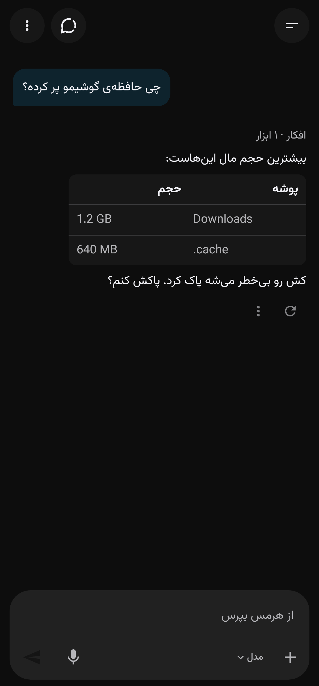
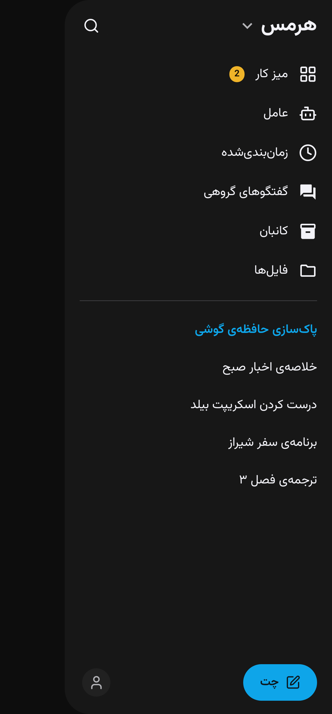
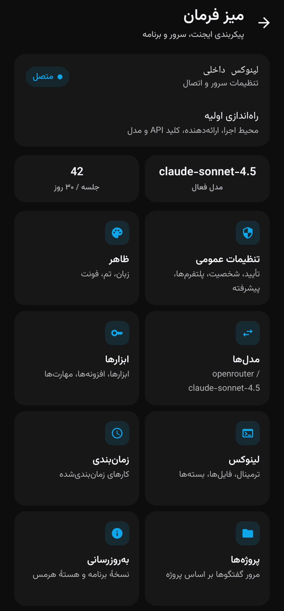
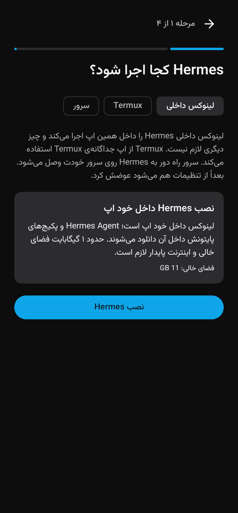
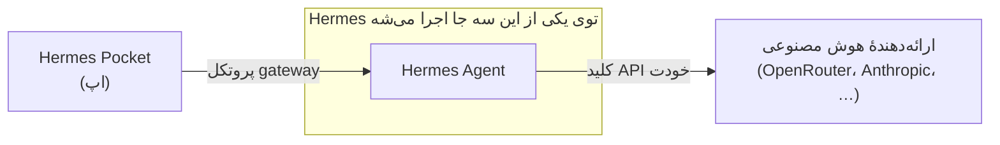

<h1 align="center">⬡ Hermes Pocket</h1>

<p align="center" dir="rtl">
  <strong>اپ کامل اندروید برای <a href="https://github.com/NousResearch/hermes-agent">Hermes Agent</a>.</strong><br>
  کل ایجنت رو روی خود گوشی اجرا می‌کنه، بدون سرور و بدون روت؛ یا به ایجنتی که روی سرور خودت داری وصل می‌شه.
</p>

<p align="center">
  <a href="README.md">English</a> •
  <a href="#باهاش-چه-کارهایی-می‌شه-کرد">چه کارهایی می‌کنه</a> •
  <a href="#شروع">شروع</a> •
  <a href="#چطور-کار-می‌کنه">چطور کار می‌کنه</a> •
  <a href="#سؤال‌های-رایج">سؤال‌های رایج</a>
</p>

<p align="center">
  <a href="https://github.com/traveler3022/Hermes-Pocket/releases/latest/download/app-release.apk"></a>
  <br>
  <a href="https://github.com/traveler3022/Hermes-Pocket/actions/workflows/build-apk.yml"></a>
  
  <a href="LICENSE"></a>
</p>

<p align="center">
  <table>
    <tr>
      <td></td>
      <td></td>
      <td></td>
      <td></td>
    </tr>
  </table>
</p>

<div dir="rtl">

---

## این چیه؟

[Hermes Agent](https://github.com/NousResearch/hermes-agent) یک ایجنت هوش مصنوعی متن‌باز از Nous Research است.
فقط جواب نمی‌ده: دستور اجرا می‌کنه، فایل می‌خونه و می‌نویسه، کد می‌نویسه و اجرا می‌کنه، توی وب می‌گرده،
چیزهایی از تو یادش می‌مونه و کارها رو سر وقتش انجام می‌ده. معمولاً از ترمینال یا اپ دسکتاپش روی کامپیوتر
استفاده می‌شه.

**Hermes Pocket همهٔ این‌ها رو میاره روی اندروید.** یک پنجرهٔ چت دور یک API نیست. با Hermes همون‌طوری حرف
می‌زنه که اپ رسمی دسکتاپ حرف می‌زنه، برای همین همون چیزها رو نشون می‌ده: فکر کردن ایجنت و ابزارهایی که صدا
زده، تأییدها، فایل‌هایی که ساخته، حافظه‌اش، کارهای زمان‌بندی‌شده‌اش، کانبانش.

و می‌تونه **خود ایجنت رو هم میزبانی کنه**. اپ یک لینوکس کوچیک همراه خودش داره، Hermes رو داخلش نصب می‌کنه و
توی پس‌زمینه روشن نگهش می‌داره. گوشیت می‌شه همون کامپیوتری که ایجنت روش کار می‌کنه. اگه ترجیح می‌دی ایجنت
روی سرور بمونه، اپ از راه Tailscale که داخل خودش هست، خصوصی بهش وصل می‌شه.

| | ایجنت کجا اجرا می‌شه | چی لازمه |
|---|---|---|
| **🐧 لینوکس داخلی** *(پیشنهادی)* | داخل همین اپ، روی گوشی | هیچی. یک بار حدود ۱ گیگ جای خالی |
| **📟 ترموکس** | توی اپ Termux روی گوشی | نصب بودن Termux |
| **🖥️ سرور خودت** | روی سرور لینوکسی خودت | یک سرور و حساب رایگان Tailscale ← [راهنمای سرور](server/README.fa.md) |

هر وقت خواستی از کارت بالای **میز فرمان** بینشون جابه‌جا شو.

## باهاش چه کارهایی می‌شه کرد

### با ایجنتی حرف بزن که کار رو انجام می‌ده

- جواب همون‌طور که نوشته می‌شه میاد. بالای هر جواب، بخش تاشوی **افکار** نشون می‌ده ایجنت چی فکر کرده و
  کدوم ابزارها رو با چه ورودی و چه نتیجه‌ای صدا زده.
- دستورهای پرخطر رو **تأیید یا رد** کن، توی چت یا مستقیم از اعلان (تأیید، همیشه، رد). وقتی ایجنت جواب یک
  سؤال، رمز sudo یا یک کلید لازم داره، توی یک کارت داخل چت می‌پرسه.
- وسط جواب **هدایتش کن**، یا از هر پیامی ویرایش کن، دوباره بگیر یا شاخه بزن.
- **تغییرات** همهٔ فایل‌هایی که یک چت عوض کرده رو نشون می‌ده و می‌تونی به یک نقطهٔ قبلی برگردی.
  **کانتکست** نشون می‌ده چی پنجرهٔ کانتکست مدل رو پر کرده.
- هرچی ایجنت می‌سازه توی چت دیده می‌شه: عکس، ویدیو و صدا (صدا با صفحهٔ خاموش هم پخش می‌شه)، صفحه‌های HTML
  و ویجت‌های زنده‌ای که می‌سازه، کد، جدول و نمودار. هر فایلی تمام‌صفحه هم باز می‌شه.
- ورودی صوتی، پیوست فایل، و انتخاب مدل همون‌جا کنار کادر پیام.
- متن فارسی و متن قاطی فارسی و انگلیسی با جهت درست خونده می‌شه.

### کار رو بسپار و برو

- **میز کار**: یک کار به ایجنت بده، اپ رو ببند، و نتیجه رو با اعلان بگیر. Hermes با صفحهٔ خاموش هم کار
  می‌کنه و بعد از ری‌استارت گوشی دوباره روشن می‌شه.
- **زمان‌بندی‌شده**: کارهایی که خودشون اجرا می‌شن. با زبان ساده بگو کی، یا از کارهای آمادهٔ Hermes شروع کن.
- **کانبان**: بردهای کار که ایجنت‌ها روشون کار می‌کنن: فیلتر، تلاش دوباره، فایل برای هر کار، کاری که منتظر کار
  دیگه است، خروجی و ورودی. پیش‌فرض خاموشه؛ از تنظیمات روشنش کن.

### یک تیم ایجنت داشته باش

- **پروفایل‌ها**: ایجنت‌های جدا، هرکدوم با شخصیت (SOUL.md)، حافظه و مدل خودش. از عنوان کشوی کنار بینشون
  جابه‌جا شو.
- **گفتگوهای گروهی**: ۲ تا ۶ پروفایل رو توی یک اتاق بذار. با هم جواب می‌دن و می‌تونن با اسم همدیگه رو صدا بزنن.

### یک کامپیوتر لینوکسی داخل اپ

با لینوکس داخلی، ایجنت روی یک لینوکس واقعی کار می‌کنه که داخل خود اپه:

- **ترمینال** کامل، و بسته‌هایی که با یک لمس اضافه می‌شن.
- فایل‌های لینوکس توی اپ **Files** اندروید و همهٔ انتخابگرهای فایل دیده می‌شن. قبل از این‌که فایلِ یک برنامهٔ
  لینوکسی بره سمت گوشی، اپ اول از تو می‌پرسه.
- **مرورگر روی دسکتاپ مجازی**: ایجنت Chromium رو می‌گردونه، و تو می‌تونی زنده تماشا کنی و با لمس و کیبورد
  کنترل رو بگیری.

### همه‌چیز رو از خود گوشی تنظیم کن

همه‌چیز توی **میز فرمان** هست:

- **مدل‌ها و ارائه‌دهنده‌ها**: OpenRouter، Anthropic، OpenAI، Gemini، DeepSeek، Xiaomi MiMo، Z.AI / GLM،
  Kimi یا هر endpoint سازگار با OpenAI، با کلید API یا ورود با حساب. عمق تفکر رو انتخاب کن. قبل از انتخاب
  مدلی که هزینهٔ بالا یا سیاست دادهٔ مهمی داره، اپ هشدار می‌ده.
- **ابزارها**: گروه‌های ابزار (و این‌که هرکدوم از چه سرویسی با چه کلیدی استفاده کنه)، افزونه‌ها، مهارت‌ها
  (دیدن، ویرایش، نصب از هاب) و سرورهای MCP.
- **حافظه**: فایل‌های حافظهٔ ایجنت، و اگه بخوای یک ارائه‌دهندهٔ حافظهٔ بیرونی.
- **پیام‌رسان‌ها**: از تلگرام، دیسکورد یا اسلک به ایجنتت پیام بده. ربات تلگرام خودت رو قدم‌به‌قدم وصل کن، و
  تعیین کن کی اجازه داره باهاش حرف بزنه.
- **چت‌ها و پروژه‌ها**: توی چت‌های قبلی بگرد، بر اساس پروژه ببینشون، چت‌های خالی یا قدیمی رو پاک کن.
- **فضای ذخیره‌سازی**: ببین توی کل اپ چی جا گرفته و چیزی رو که لازم نداری پاک کن.
- **به‌روزرسانی** اپ و هستهٔ Hermes، **فارسی و انگلیسی**، هفت تم رنگی روشن و تیره، و انتخاب فونت.

## شروع

1. **[APK آخرین نسخه رو دانلود کن](https://github.com/traveler3022/Hermes-Pocket/releases/latest/download/app-release.apk)** و نصبش کن.
2. اپ رو باز کن، **شروع** رو بزن و انتخاب کن Hermes کجا اجرا بشه:
   - **لینوکس داخلی**: **نصب Hermes** رو بزن و تا خودش رو راه بندازه اپ رو باز نگه دار
     (یک بار حدود ۱ گیگ جای خالی و اینترنت پایدار).
   - **ترموکس**: مراحلی که اپ نشون می‌ده رو انجام بده.
   - **سرور خودت**: یک دستور روی سرور اجرا کن، بعد از اپ وارد شو. [راهنمای سرور](server/README.fa.md) رو ببین.
3. ارائه‌دهندهٔ هوش مصنوعی رو انتخاب کن، کلید API رو بذار (یا وارد شو) و یک مدل انتخاب کن.
4. یه چیزی ازش بپرس. 👋

**لازمه:** اندروید ۱۰ یا جدیدتر، روی گوشی arm64 یا x86_64.

## چطور کار می‌کنه



- **لینوکس داخلی**: APK یک لینوکس کوچیک همراه خودش داره. اپ بازش می‌کنه و با proot اجراش می‌کنه، پس نه روت
  لازمه نه اپ دیگه‌ای. Hermes داخلش نصب می‌شه و مستقیم با اپ حرف می‌زنه.
- **ترموکس**: Hermes توی Termux اجرا می‌شه و اپ روی خود گوشی بهش وصل می‌شه.
- **سرور**: Hermes روی سرور می‌مونه و فقط روی `127.0.0.1` گوش می‌ده. اپ از راه Tailscale که داخل خودش هست
  بهش می‌رسه، پس هیچ پورتی به روی اینترنت باز نمی‌شه.

## حریم خصوصی و امنیت

- توی دو حالت روی گوشی، چت‌ها، فایل‌ها و کلیدهای API روی خود گوشی می‌مونن. تنها درخواست‌هایی که بیرون می‌رن
  به ارائه‌دهنده‌ایه که خودت انتخاب کردی. بدون حساب کاربری، بدون ردیابی، بدون سرورِ ما.
- با سرور، فقط دستگاه‌هایی که با حساب Tailscale خودت وارد شدن بهش می‌رسن. اپ اطلاعات ورود رو رمزشده روی
  گوشی نگه می‌داره.
- Hermes دستور واقعی اجرا می‌کنه. تأیید دستورها رو روشن نگه دار؛ سخت‌گیریش رو از میز فرمان تنظیم کن.

> [!CAUTION]
> هیچ‌وقت کلید API رو توی اسکرین‌شات یا issue نذار.

## سؤال‌های رایج

<details>
<summary><b>سرور یا کامپیوتر لازمه؟</b></summary>

نه. با لینوکس داخلی کل ایجنت روی گوشی اجرا می‌شه. سرور فقط یکی از گزینه‌هاست.
</details>

<details>
<summary><b>گوشی باید روت باشه؟</b></summary>

نه. لینوکس داخلی بدون روت کار می‌کنه.
</details>

<details>
<summary><b>این اپ رسمی Hermes است؟</b></summary>

نه. یک پروژهٔ مستقل است و وابسته به Nous Research نیست.
</details>

<details>
<summary><b>ایجنت با خاموش شدن صفحه متوقف می‌شه.</b></summary>

تنظیمات ← برنامه‌ها ← Hermes ← باتری ← **بدون محدودیت**.
</details>

<details>
<summary><b>نصب وسط کار متوقف شد یا خطا داد.</b></summary>

جا خالی کن (حداقل ۱ گیگ)، اینترنت رو چک کن و دوباره نصب رو بزن.
</details>

<details>
<summary><b>اپ به سرورم وصل نمی‌شه.</b></summary>

گوشی و سرور باید با یک حساب Tailscale وارد شده باشن. [راهنمای سرور](server/README.fa.md) رو ببین.
</details>

<details>
<summary><b>باگ رو چطور گزارش بدم؟</b></summary>

یک issue باز کن و نسخهٔ اندروید، مدل گوشی، حالتی که استفاده می‌کنی و لاگ نصب یا اتصال رو بذار.
</details>

## ساخت از سورس

</div>

```bash
git clone https://github.com/traveler3022/Hermes-Pocket.git
cd Hermes-Pocket
./gradlew :app:assembleDebug        # APK → app/build/outputs/apk/debug/
./gradlew :app:testDebugUnitTest    # unit tests
```

<div dir="rtl">

JDK 17 و Android SDK 36 لازمه. با Kotlin، Jetpack Compose، Material 3، Hilt و OkHttp ساخته شده.
هر push روی GitHub Actions ساخته و تست می‌شه.
اسکرین‌شات‌های بالا رو workflow **README Screenshots** از کد خود رابط کاربری اپ می‌کشه.

## مجوز

**GPLv3** با چند شرط اضافه (نام سازنده باید بمونه): فایل‌های [LICENSE](LICENSE) و [ADDITIONAL_TERMS.md](ADDITIONAL_TERMS.md) رو ببین.

</div>

<p align="center" dir="rtl">
  <sub>پروژهٔ مستقل · وابسته به Nous Research نیست · «Hermes Agent» متعلق به سازندگانشه.</sub>
</p>
