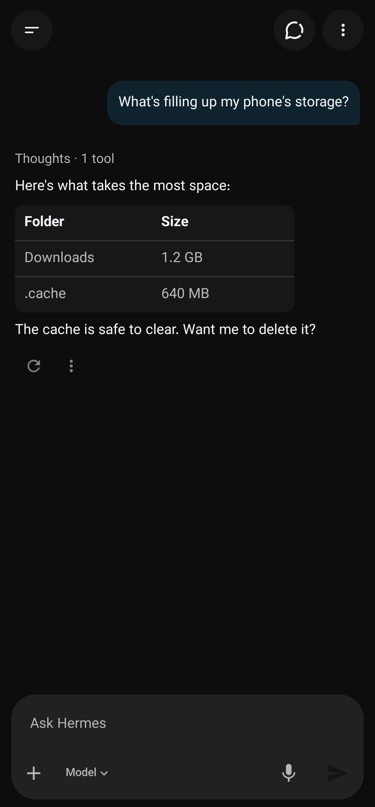
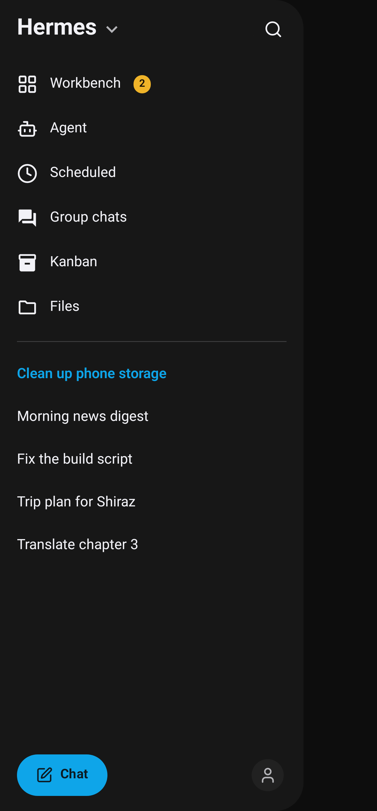
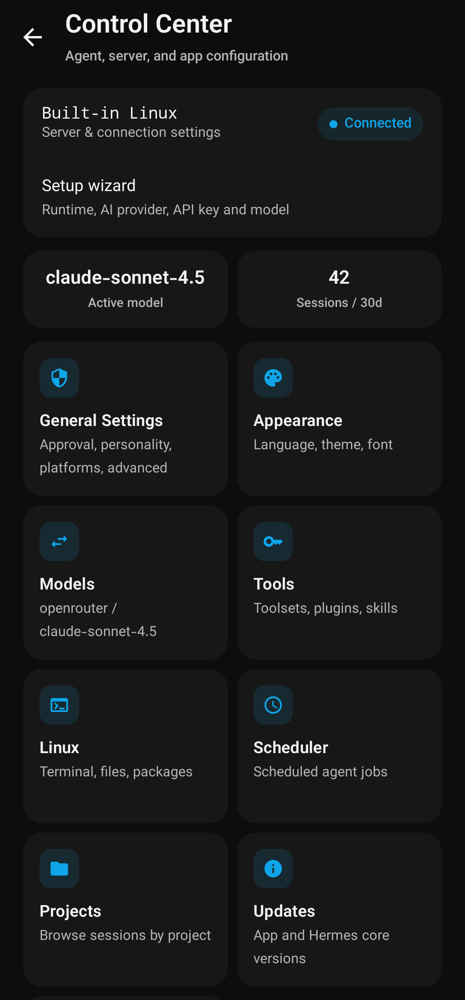
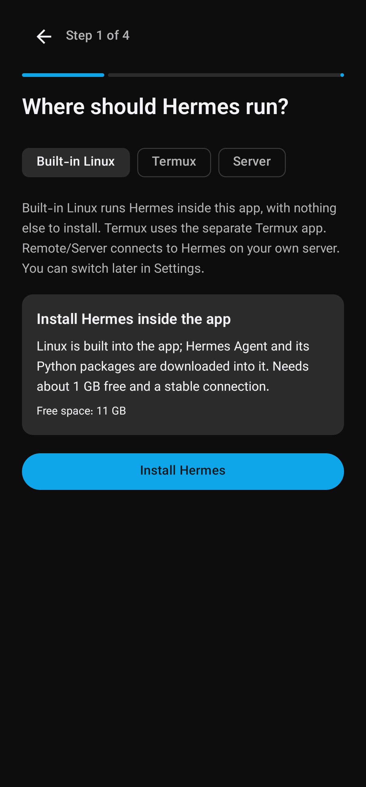
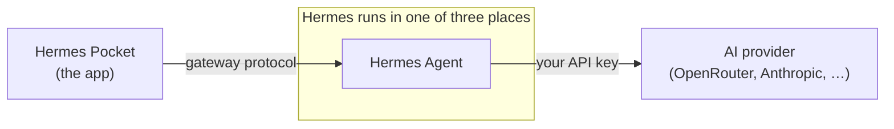

<h1 align="center">⬡ Hermes Pocket</h1>

<p align="center">
  <strong>A full Android app for <a href="https://github.com/NousResearch/hermes-agent">Hermes Agent</a>.</strong><br>
  It runs the whole agent on your phone, with no server and no root, or connects to the one on your own server.
</p>

<p align="center">
  <a href="README.fa.md">فارسی</a> •
  <a href="#what-you-can-do">What you can do</a> •
  <a href="#getting-started">Getting started</a> •
  <a href="#how-it-works">How it works</a> •
  <a href="#faq">FAQ</a>
</p>

<p align="center">
  <a href="https://github.com/traveler3022/Hermes-Pocket/releases/latest/download/app-release.apk"></a>
  <br>
  <a href="https://github.com/traveler3022/Hermes-Pocket/actions/workflows/build-apk.yml"></a>
  
  <a href="LICENSE"></a>
</p>

<p align="center">
  <table>
    <tr>
      <td></td>
      <td></td>
      <td></td>
      <td></td>
    </tr>
  </table>
</p>

---

## What is this?

[Hermes Agent](https://github.com/NousResearch/hermes-agent) is an open-source AI agent from Nous Research.
It doesn't just answer: it runs shell commands, reads and writes files, writes and runs code, searches and
browses the web, remembers things about you, and runs jobs on a schedule. Normally you use it from a
terminal or from its desktop app on a computer.

**Hermes Pocket brings all of that to Android.** It isn't a chat window around an API. It talks to Hermes
the same way the official desktop app does, so it shows the same things: the agent's reasoning and tool
calls, approvals, the files it makes, its memory, its scheduled jobs, its Kanban board.

And it can **host the agent itself**. The app carries a small Linux system, installs Hermes inside it, and
keeps it running in the background. Your phone becomes the computer the agent works on. If you'd rather
keep the agent on a server, the app connects to it privately over Tailscale, which is built in.

| | Where the agent runs | What you need |
|---|---|---|
| **🐧 Built-in Linux** *(recommended)* | Inside the app, on the phone | Nothing else. About 1 GB free, once |
| **📟 Termux** | In the Termux app on the phone | Termux installed |
| **🖥️ Your server** | On your own Linux server | A server and a free Tailscale account → [server guide](server/README.md) |

You can switch between them at any time from the top card of **Control Center**.

## What you can do

### Talk to an agent that does the work

- Replies stream in as they're written. Above each one, a folding **Thoughts** trace shows what the agent
  thought and which tools it called, with their arguments and results.
- **Approve or deny** risky commands, in the chat or straight from the notification (Approve, Always, Deny).
  When the agent needs an answer, a sudo password or a secret, it asks in a card inside the chat.
- **Steer** the agent while it's still answering, or edit, retry or branch the chat from any message.
- **Changes** shows every file a chat changed and lets you roll back to an earlier checkpoint.
  **Context** shows what is filling the model's context window.
- What the agent makes appears in the chat: images, video and audio (audio keeps playing with the screen
  off), HTML pages and live widgets it builds, code, tables and diagrams. Any file opens full screen.
- Voice input, attachments, and a model picker right in the composer.
- Persian and mixed Persian/English text reads in the right direction.

### Hand off work and walk away

- **Workbench**: give the agent a task, close the app, and get a notification with the result.
  Hermes keeps running with the screen off and starts again after a reboot.
- **Scheduled**: jobs that run on their own. Say when in plain words, or start from Hermes' ready-made jobs.
- **Kanban**: boards of tasks your agents work through: filters, retries, task files, tasks that wait on
  other tasks, export and import. Off by default; turn it on in Settings.

### Run a team of agents

- **Profiles**: separate agents, each with its own personality (SOUL.md), memory and model.
  Switch between them from the drawer title.
- **Group chats**: put 2 to 6 profiles in one room. They answer together and can call on each other by name.

### A Linux computer inside the app

With Built-in Linux, the agent works on a real Linux system that lives in the app:

- A full **terminal**, and package sets you can add with one tap.
- The Linux files appear in Android's **Files** app and in every file picker. Before a Linux program's file
  leaves for the phone, the app asks you first.
- A **browser on a virtual desktop**: the agent drives Chromium, and you can watch it live and take over
  with touch and the keyboard.

### Set everything up from the phone

Everything lives in **Control Center**:

- **Models and providers**: OpenRouter, Anthropic, OpenAI, Gemini, DeepSeek, Xiaomi MiMo, Z.AI / GLM,
  Kimi, or any OpenAI-compatible endpoint, by API key or account sign-in. Pick reasoning depth. The app
  warns you before you pick a model with high cost or a data policy you should know about.
- **Tools**: toolsets (and which service each one uses, with its keys), plugins, skills (browse, edit,
  install from the hub) and MCP servers.
- **Memory**: the agent's memory files, and an external memory provider if you want one.
- **Messaging platforms**: reach your agent from Telegram, Discord or Slack. Connect your own Telegram bot
  step by step, and approve or revoke who may talk to it.
- **Sessions and projects**: search old chats, browse them by project, clean up empty or old ones.
- **Storage**: see what takes space across the whole app and clear what you don't need.
- **Updates** for the app and for the Hermes core, **English and Persian**, seven color themes in light
  and dark, and a choice of font.

## Getting started

1. **[Download the APK](https://github.com/traveler3022/Hermes-Pocket/releases/latest/download/app-release.apk)** of the latest release and install it.
2. Open the app, tap **Get started**, and pick where Hermes runs:
   - **Built-in Linux**: tap **Install Hermes** and keep the app open while it sets itself up
     (about 1 GB free and a stable connection, once).
   - **Termux**: follow the steps the app shows.
   - **Your server**: run one command on the server, then sign in from the app. See the
     [server guide](server/README.md).
3. Choose your AI provider, paste your API key (or sign in), and pick a model.
4. Ask it something. 👋

**Needs** Android 10 or newer on an arm64 or x86_64 phone.

## How it works



- **Built-in Linux**: the APK carries a small Linux system. The app unpacks it and runs it with proot, so
  no root and no other app is needed. Hermes is installed inside it and talks to the app directly.
- **Termux**: Hermes runs in Termux, and the app connects to it on the phone.
- **Server**: Hermes stays on your server, listening only on `127.0.0.1`. The app reaches it through
  Tailscale, which is built into the app, so no port is opened to the internet.

## Privacy and security

- In the two on-phone modes, your chats, files and API keys stay on the phone. The only requests that
  leave it go to the AI provider you chose. No account, no telemetry, no server of ours.
- With a server, only devices signed in to your own Tailscale account can reach it. The app keeps the
  login encrypted on the phone.
- Hermes runs real commands. Keep approvals on; you choose how strict they are in Control Center.

> [!CAUTION]
> Never share your API key in screenshots or issues.

## FAQ

<details>
<summary><b>Do I need a server or a computer?</b></summary>

No. With Built-in Linux the whole agent runs on the phone. A server is only one of the options.
</details>

<details>
<summary><b>Does my phone need to be rooted?</b></summary>

No. Built-in Linux runs without root.
</details>

<details>
<summary><b>Is this the official Hermes app?</b></summary>

No. It's an independent community project and is not affiliated with Nous Research.
</details>

<details>
<summary><b>The agent stops when the screen is off.</b></summary>

Settings → Apps → Hermes → Battery → **Unrestricted**.
</details>

<details>
<summary><b>Setup stopped or failed.</b></summary>

Free up space (at least 1 GB), check your connection, and tap Install again.
</details>

<details>
<summary><b>The app can't reach my server.</b></summary>

The phone and the server must be signed in to the same Tailscale account. See the
[server guide](server/README.md).
</details>

<details>
<summary><b>How do I report a bug?</b></summary>

Open an issue with your Android version, phone model, which mode you use, and the install or connection log.
</details>

## Build from source

```bash
git clone https://github.com/traveler3022/Hermes-Pocket.git
cd Hermes-Pocket
./gradlew :app:assembleDebug        # APK → app/build/outputs/apk/debug/
./gradlew :app:testDebugUnitTest    # unit tests
```

Needs JDK 17 and Android SDK 36. Built with Kotlin, Jetpack Compose, Material 3, Hilt and OkHttp.
Every push is built and tested on GitHub Actions.
The screenshots above are drawn from the app's own UI code by the **README Screenshots** workflow.

## License

**GPLv3** with additional terms (keep the author attribution): see [LICENSE](LICENSE) and
[ADDITIONAL_TERMS.md](ADDITIONAL_TERMS.md).

<p align="center">
  <sub>Independent community project · not affiliated with Nous Research · "Hermes Agent" belongs to its authors.</sub>
</p>
